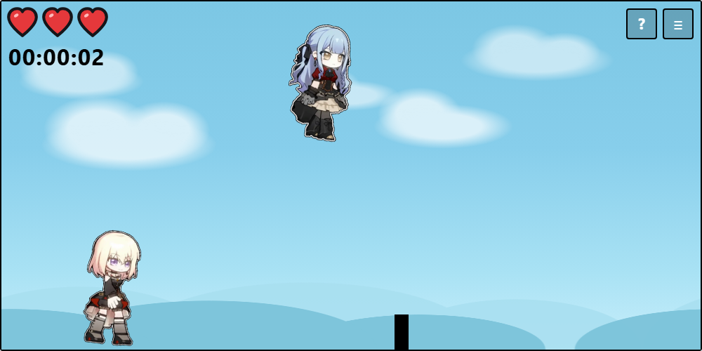

# sakiRUN

一个用 **Vue 3 + TypeScript + Vite** 重写的网页跑酷小游戏。



## 玩法

- 按 **空格** 或点击画面，让主角「祥子」跳跃，躲开迎面而来的方块。
- 生命值 3 颗心，每撞到一次方块减少一颗，全部失去后游戏结束。
- 计时器记录本局生存时间；右上角 `≡` 暂停 / 继续，`?` 打开测试菜单。

## 技术栈

| 能力     | 方案                                              |
| -------- | ------------------------------------------------- |
| 构建     | Vite 8（`vite build`，`base: './'`）              |
| 界面     | Vue 3.5 `<script setup>` 单文件组件               |
| 类型     | TypeScript 6（`strict`、`noUncheckedIndexedAccess`） |
| 类型检查 | vue-tsc                                           |
| 样式     | 原生 CSS（`src/styles`），图片由 Vite 打包并哈希  |

## 本地开发

需要 Node.js >= 20.19。

```sh
npm install     # 安装依赖
npm run dev     # 开发服务器
npm run build   # 类型检查 + 生产构建，产物在 dist/
npm run preview # 预览 dist/
npm run typecheck
```

## 目录结构

```
sakiRUN/
├─ index.html                # Vite 入口 HTML
├─ vite.config.ts            # 别名 @ -> src、相对 base
├─ tsconfig.json
├─ assets/whenRunning.png    # README 截图
├─ public/favicon.svg
└─ src/
   ├─ main.ts                # 创建应用、加载全局样式
   ├─ App.vue                # 页面骨架 + 操作提示
   ├─ components/
   │  ├─ GameStage.vue       # 舞台：渲染角色 / 障碍物 / HUD / 遮罩，处理缩放
   │  ├─ StageBackdrop.vue   # 视差背景：云层与山丘分层滚动
   │  ├─ GameHud.vue         # 生命值 + 计时器
   │  ├─ HeartIcon.vue       # 矢量心形（内联 SVG，满心 / 空心槽）
   │  ├─ GameOverlay.vue     # 开始 / 暂停 / 结束面板
   │  └─ TestMenu.vue        # 调试菜单
   ├─ composables/
   │  └─ useSakiRun.ts       # 状态机 + 唯一的 rAF 循环 + 输入
   ├─ game/                  # 与框架无关的游戏规则（纯函数）
   │  ├─ constants.ts        # 全部可调参数
   │  ├─ types.ts
   │  ├─ saki.ts             # 跳跃抛物线
   │  ├─ blocks.ts           # 障碍物移动与回收
   │  ├─ spawner.ts          # 生成节奏
   │  ├─ collision.ts        # 轴对齐包围盒碰撞
   │  ├─ clock.ts            # HH:MM:SS 格式化
   │  └─ random.ts
   ├─ styles/
   │  ├─ base.css            # 页面骨架
   │  └─ game.css            # 舞台、实体、HUD、按钮、动画
   └─ assets/                # 角色图片（import 后由 Vite 处理）
```

## 设计说明

- **单一游戏循环**：`useSakiRun` 用一个 `requestAnimationFrame` 循环驱动全部逻辑，
  暂停就是停止循环，因此跳跃、障碍物、计时会同时冻结。
- **逻辑坐标固定**：舞台内部始终按 1000 × 500 布局，外层按容器宽度整体
  `transform: scale()`，所以移动端不需要再写一套尺寸，也不会出现越界。
- **视差背景**：`StageBackdrop` 用 4 层可无缝平铺的天空贴图（远云、近云、远山、近山）
  以不同速度向左循环滚动，越靠前越快，形成向后退去的速度感；暂停或结束时随游戏一起冻结。
- **规则与渲染分离**：`src/game/*` 是不依赖 Vue 的纯函数，组件只消费状态；
  跳跃曲线、碰撞、生成节奏都可以单独测试。
- **矢量 HUD**：生命值用内联 SVG 心形（`HeartIcon`）绘制，满心为红色填充 + 黑色描边，
  空心槽只留描边；不依赖位图，随舞台缩放与高 DPI 屏幕都保持清晰。
- **资源交给 Vite**：图片放在 `src/assets` 并通过 CSS `url()` 引入，
  构建时会带哈希输出，不再依赖 `public/` 的运行时路径。

## 相比原版的修复

- 暂停时跳跃动画仍会继续（原 `BUG` 注释）——现在随游戏循环一起冻结。
- 障碍物移出屏幕后不会被销毁，会一直累积——现在按边界回收。
- 移动端没有键盘、无法跳跃——现在支持点击 / 触摸画面跳跃。
- 开始与重新开始的首个障碍物生成时间不一致——现在统一由 `spawner` 调度。

## 部署

`npm run build` 生成 `dist/`，`base` 已设为相对路径，可直接放到博客的任意子目录
（例如 `https://example.com/sakirun/`）。

## License

[MIT](./LICENSE) © 2025 XiaoMuSWW
